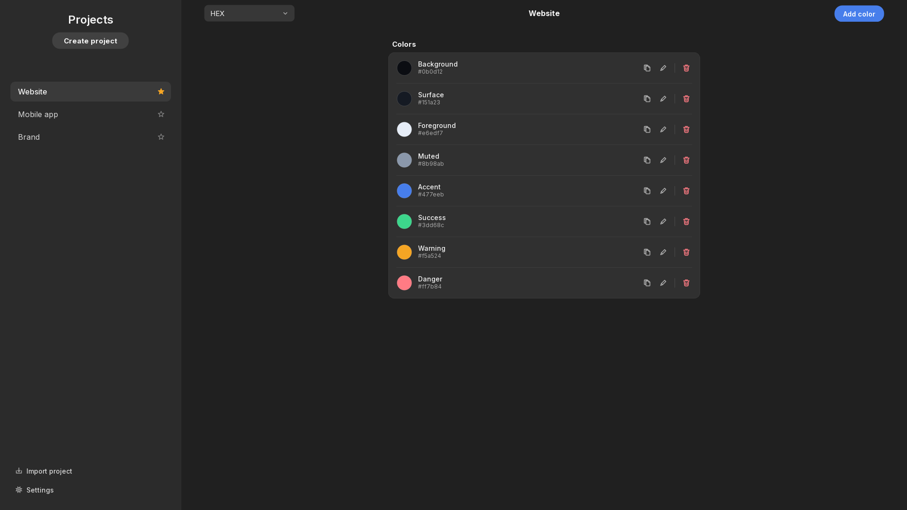

  

<h1 align="center">vColor</h1>

A fast, native desktop color project manager for Linux, macOS, and Windows,
with interchangeable palette formats for importing, exporting, and sharing
colors.

> [!WARNING]
> This app is 100% vibe coded. lol

## Documentation

- [Usage](docs/USAGE.md) — features, keyboard shortcuts, and where your data lives
- [Palette projects](docs/PROJECTS.md) — supported formats, naming, import/export, and drag-and-drop
- [Development](docs/DEVELOPMENT.md) — running from source, tests, and building desktop bundles
- [AGENTS.md](AGENTS.md) — project/theme recipes for AI assistants and coding agents

## License

- [MIT](LICENSE). 
- The bundled Inter font is licensed under the SIL Open Font License; see `vcolor/resources/fonts/OFL.txt`.
